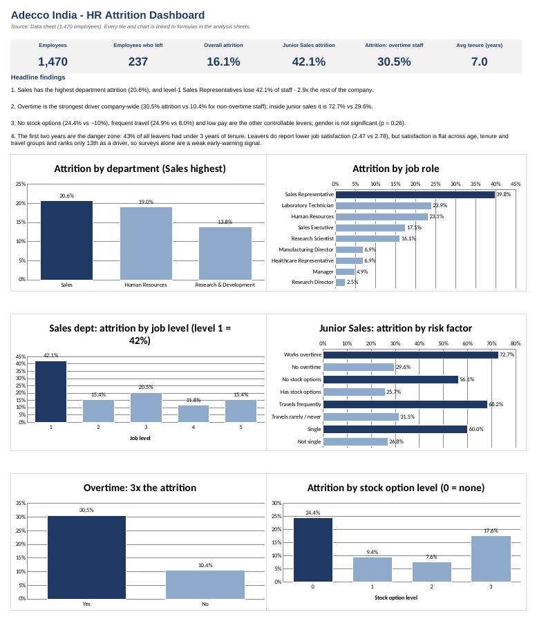
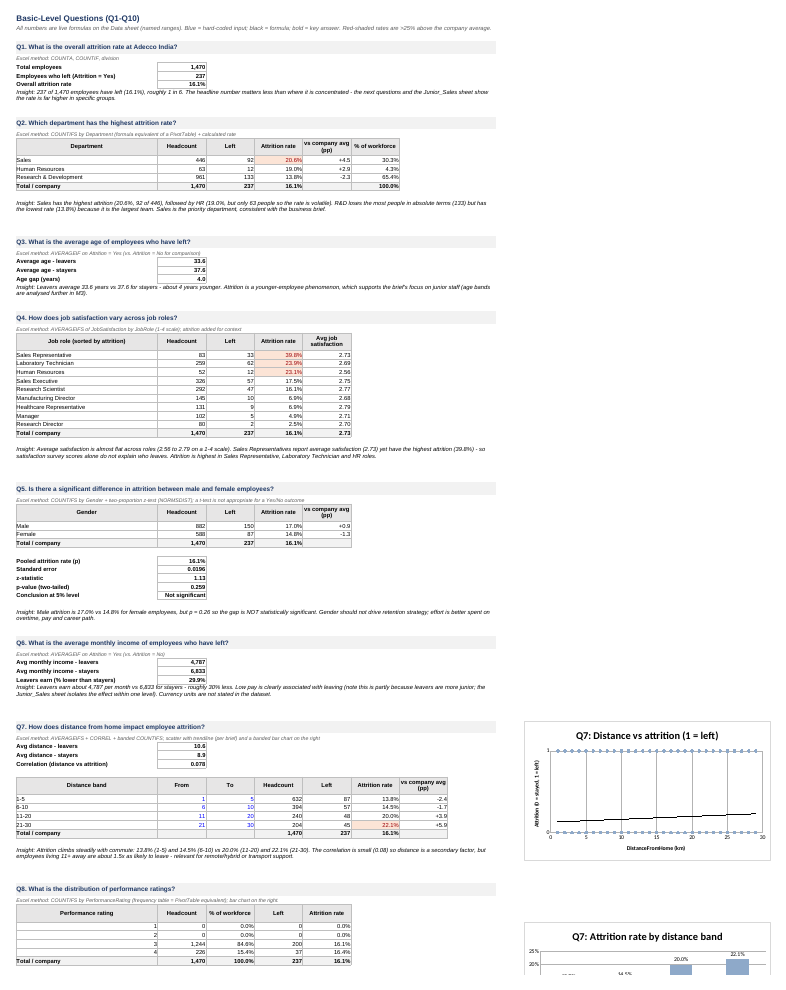
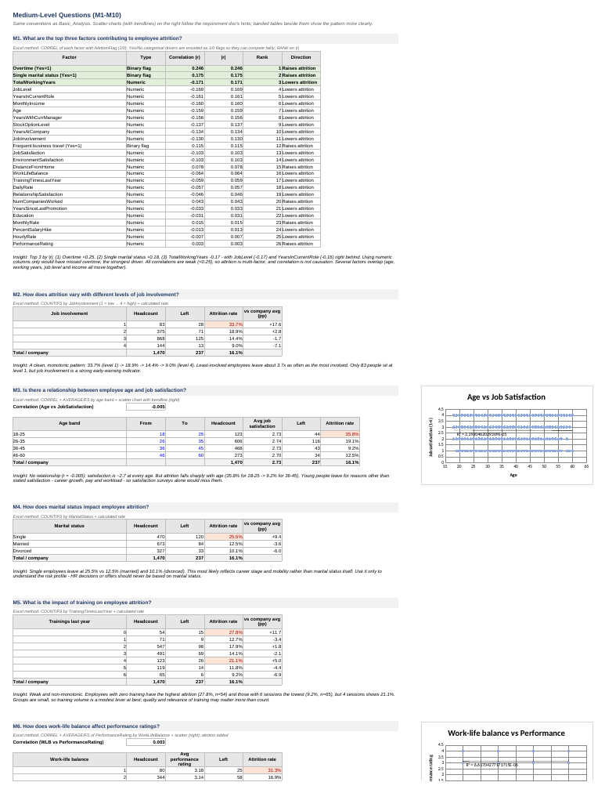
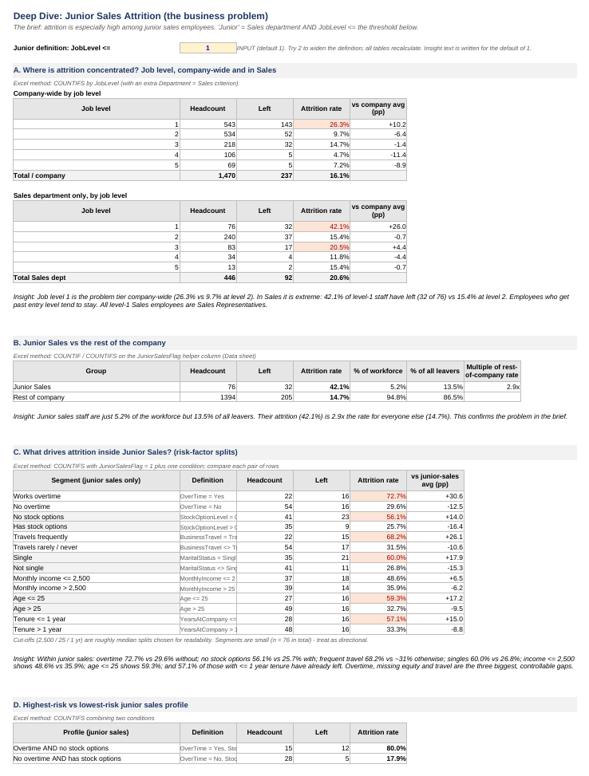
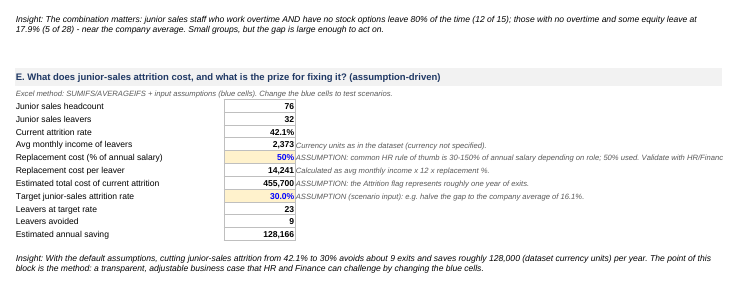
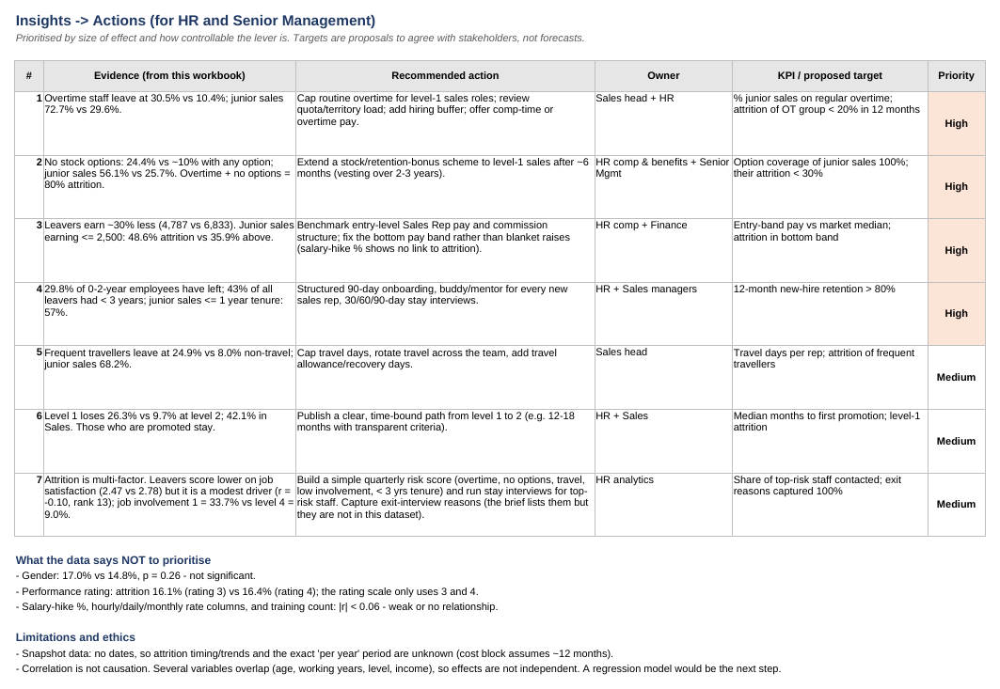

# HR Analytics: Boosting Retention at Adecco India

**An Excel case study that finds why junior sales staff are leaving, and what to do about it.**

> **Headline:** Level-1 junior sales employees leave at **42.1%**, nearly **3x** the rest of the company (14.7%). They are 5% of the workforce but 13.5% of all leavers. **Overtime, no stock options, frequent travel and low pay** are the controllable drivers; gender is not.



---

## 1. Business problem

Adecco India (a mid-sized software company) is seeing rising turnover, especially among **junior employees in Sales**. Attrition drives recruitment and training costs and disrupts team performance. As the analyst, I was asked to find the factors behind attrition and recommend targeted retention actions for HR and senior management.

- **Data:** 1,470 employees x 35 attributes (HR records, satisfaction scores, pay, tenure, overtime, etc.). No missing values, no duplicates.
- **Tool:** Microsoft Excel only (formulas, named ranges, conditional formatting, native charts). No code needed to reproduce.
- **Brief:** the 20 case-study questions (10 basic, 10 medium) in [`docs/Case_Study_Brief.docx`](docs/Case_Study_Brief.docx).

## 2. Key findings

| # | Finding | Evidence |
|---|---|---|
| 1 | **Sales** has the highest attrition of any department | 20.6% (92 of 446) vs 16.1% company-wide |
| 2 | The problem is **concentrated in level-1 Sales Representatives** | 42.1% (32 of 76) vs 15.4% at level 2 |
| 3 | **Overtime** is the strongest driver | 30.5% vs 10.4% for non-overtime staff; **72.7% vs 29.6%** in junior sales |
| 4 | **No stock options** roughly 2.5x attrition | 24.4% vs 9.9% with any option |
| 5 | **Frequent travel** triples attrition | 24.9% vs 8.0% for non-travellers |
| 6 | Leavers are **younger, newer and lower paid** | Age 33.6 vs 37.6; tenure 5.1 vs 7.4 yrs; pay 4,787 vs 6,833 / month |
| 7 | The **first two years** are the danger zone | 29.8% attrition at 0-2 yrs; 43% of all leavers had < 3 yrs |
| 8 | **Gender is not a factor** | 17.0% vs 14.8%, z-test p = 0.26 |
| 9 | **Satisfaction is a weak early-warning signal** | Leavers score lower (2.47 vs 2.78) but it ranks only 13th of 26 drivers (r = -0.10); ~2.7 in every age, tenure and travel group |
| 10 | The riskiest junior-sales profile (overtime + no options) leaves **80%** of the time | 12 of 15 employees |

## 3. Answers to the 20 case-study questions

Every answer is a live formula in the workbook (sheets `Basic_Analysis` and `Medium_Analysis`), with the Excel method named beside it.



### Basic

| Q | Question | Answer |
|---|---|---|
| 1 | Overall attrition rate | **16.1%** (237 of 1,470) |
| 2 | Department with highest attrition | **Sales, 20.6%** (HR 19.0%, R&D 13.8%) |
| 3 | Average age of leavers | **33.6 years** (stayers 37.6) |
| 4 | Job satisfaction by role | Flat, 2.56 to 2.79 on a 1-4 scale; Sales Reps average 2.73 yet have the highest attrition (39.8%) |
| 5 | Gender difference significant? | **No.** Male 17.0% vs female 14.8%, two-proportion z-test p = 0.26 |
| 6 | Average monthly income of leavers | **4,787** vs 6,833 for stayers (~30% lower) |
| 7 | Impact of distance from home | Attrition rises from 13.8% (1-5) to 22.1% (21-30); weak correlation (0.08) |
| 8 | Performance rating distribution | Only ratings 3 (84.6%) and 4 (15.4%) exist; no differentiation, no link to attrition |
| 9 | Employees working overtime | **416 (28.3%)**; their attrition is 30.5% vs 10.4% |
| 10 | Average tenure | **7.0 years** (median 5.0); leavers 5.1 vs stayers 7.4 |

### Medium

| Q | Question | Answer |
|---|---|---|
| M1 | Top 3 attrition factors | **Overtime (+0.25), Single marital status (+0.18), Total working years (-0.17)**; Job level (-0.17) is right behind |
| M2 | Job involvement | Clean gradient: 33.7% (level 1) to 9.0% (level 4) |
| M3 | Age vs job satisfaction | **No relationship** (r = -0.005), yet attrition falls from 35.8% (18-25) to 9.2% (36-45) |
| M4 | Marital status | Single 25.5% vs married 12.5% vs divorced 10.1% (a career-stage proxy; not for HR decisions) |
| M5 | Training | Weak and non-monotonic; 0 sessions = 27.8% (n=54) but 4 sessions = 21.1% |
| M6 | Work-life balance vs performance | **No relationship** (r = 0.003), but WLB = 1 has 31.2% attrition |
| M7 | Stock options | None: 24.4%; any: 9.9%. Level 3 is an outlier (17.6%, n=85) |
| M8 | Tenure vs satisfaction | **No relationship** (r = -0.004); attrition 29.8% at 0-2 yrs vs 6.7% at 11-20 |
| M9 | Business travel vs satisfaction | Satisfaction identical (2.70-2.79), but frequent travellers leave at 24.9% vs 8.0% |
| M10 | Years since promotion vs performance | **No relationship** (r = 0.018); ratings are ~3.1-3.2 in every band |



## 4. Deep dive: the junior sales problem

The `Junior_Sales` sheet isolates the business problem. "Junior" is an adjustable input (`JobLevel <= 1` by default) and every table recalculates when it changes.




It also includes an assumption-driven **cost scenario**: with a 50% replacement-cost assumption (blue input cells), junior-sales attrition costs roughly 456K per year, and cutting it from 42.1% to 30% saves about 128K (dataset currency units). The assumptions are flagged so HR and Finance can challenge them.

## 5. Recommendations

| Priority | Action | Owner |
|---|---|---|
| High | Cap routine overtime for level-1 sales roles; review quota and territory load | Sales head + HR |
| High | Extend stock/retention-bonus scheme to level-1 sales after ~6 months | HR comp + Senior Mgmt |
| High | Benchmark entry-level Sales Rep pay and commission; fix the bottom pay band | HR comp + Finance |
| High | 90-day onboarding, buddy/mentor, 30/60/90-day stay interviews | HR + Sales managers |
| Medium | Cap and rotate business travel | Sales head |
| Medium | Publish a clear, time-bound level 1 to 2 promotion path | HR + Sales |
| Medium | Quarterly risk score and stay interviews; capture exit-interview reasons | HR analytics |

Full table with KPIs and proposed targets is in the `Recommendations` sheet, which also lists **what the data says not to prioritise** (gender, performance rating, salary-hike %, training count) and the limitations.



## 6. How the workbook is built

| Sheet | Purpose |
|---|---|
| `Cover` | Problem, approach, sheet map, colour conventions |
| `Dashboard` | KPI tiles, headline findings, 6 charts |
| `Metrics` | The 5 metrics named in the brief (attrition, satisfaction, engagement proxy, performance, tenure) for company / junior sales / leavers / stayers |
| `Junior_Sales` | Business-problem deep dive and cost scenario |
| `Basic_Analysis` | Q1-Q10 (+ scatter with trendline and band chart for Q7, bar chart for Q8) |
| `Medium_Analysis` | M1-M10 (+ 4 scatter charts with trendlines) |
| `Recommendations` | Insight to action to owner to KPI; limitations and ethics |
| `Data_Quality` | 10 live data checks (incl. tenure-logic and age checks) and data dictionary |
| `Data` | Raw 1,470 x 35 data (unchanged) + 5 helper columns |

**Design choices**

- **Formulas, not pasted values.** About 8,000 live formulas (`COUNTIFS`, `AVERAGEIFS`, `CORREL`, `RANK`, `SUMPRODUCT`, `NORMSDIST`). Change the data or an assumption and everything updates.
- **Named ranges** (`Attrition`, `OverTime`, `JobLevel`, ...) so formulas read like sentences: `=COUNTIFS(JobLevel,$B10,Attrition,"Yes")`.
- **Summary tables instead of PivotTables.** They are auditable cell by cell and equivalent to PivotTables; they can be reproduced with PivotTables on the `Data` sheet.
- **Categorical drivers encoded as 1/0 flags** (overtime, single, frequent travel) so they can be ranked against numeric columns in the correlation analysis. Numeric-only correlation would have missed the #1 driver.
- **z-test, not t-test, for gender.** The outcome is Yes/No, so comparing two proportions is the right test.
- **Banded tables beside scatter plots.** Scatter plots against a Yes/No outcome or a 1-4 scale are unreadable, so each is paired with a banded table that shows the pattern.
- **Simple styling:** blue text = input, black = formula, bold = key answer, light yellow = assumption you can change, light orange header = helper column. Grey bands are headers only.

## 7. Limitations

- Snapshot data with no dates: timing, trends and the exact period are unknown (the cost model assumes ~12 months).
- Correlation is not causation, and several variables overlap (age, working years, level, income). A regression model is the natural next step.
- Junior-sales subgroups are small (n = 76, 32 leavers), so splits are directional.
- Marital status, gender and age are used to understand risk only, never for individual decisions.
- Exit-interview reasons, engagement scores and manager IDs (listed in the brief) are not in the dataset.

## 8. Repository structure

```
hr-attrition-adecco/
├── README.md
├── data/
│   ├── Adecco_HR_Attrition_Raw_Data.xlsx    <- raw file: 1,470 x 35, untouched
│   └── Adecco_HR_Attrition_Analysis.xlsx    <- after-analysis file: the Excel project
├── docs/Case_Study_Brief.docx               <- requirement document
└── images/                                   <- screenshots used above
```

`Adecco_HR_Attrition_Raw_Data.xlsx` is identical to the Kaggle source data and is never edited. The analysis workbook contains its own copy on the `Data` sheet (plus 5 helper columns) so every formula stays live.

## 9. Data source

The case study is fictional. The dataset is a publicly available sample HR dataset from [Kaggle](https://www.kaggle.com/datasets/bhanupratapbiswas/hr-analytics-case-study).
